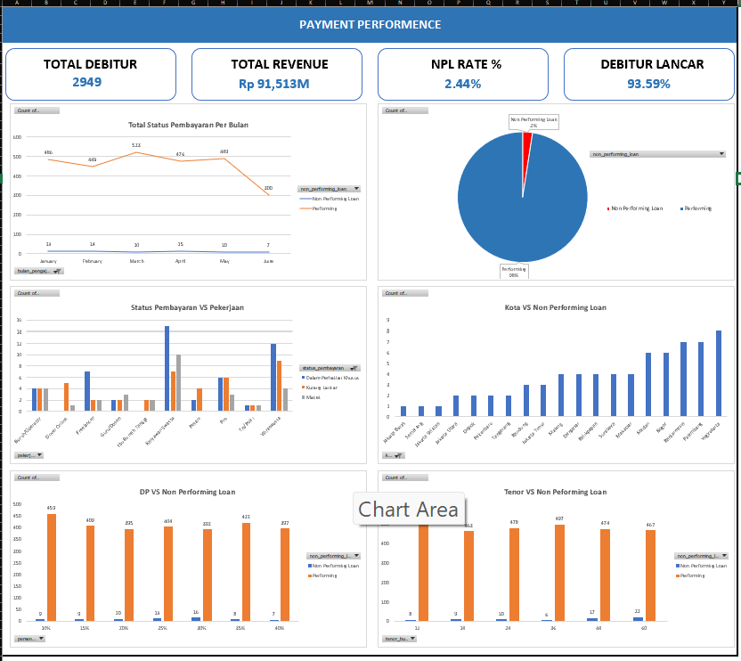
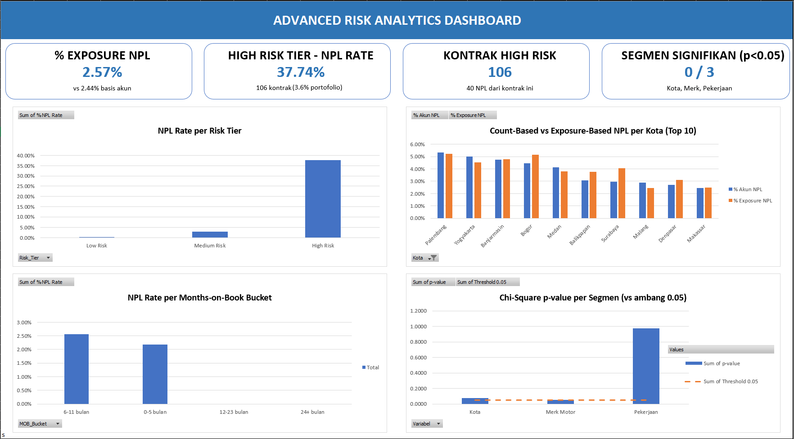

# Motorcycle Financing: Credit Risk Analytics & NPL Risk Segmentation

> **End-to-end credit risk analysis** di Excel (formula-driven, native PivotTable & chart) untuk mengidentifikasi, mengukur, dan memvalidasi segmen debitur berisiko tinggi pada portofolio pembiayaan motor.

---

## Daftar Isi

1. [Business Understanding](#1-business-understanding)
2. [Data Source](#2-data-source)
3. [Environment & Tech Stack](#3-environment--tech-stack)
4. [Data Cleaning](#4-data-cleaning)
5. [Data Extraction & Feature Engineering](#5-data-extraction--feature-engineering)
6. [Key Findings](#6-key-findings)
7. [Dashboard](#7-dashboard)
8. [Insights & Strategic Recommendations](#8-insights--strategic-recommendations)
9. [Limitations & Methodology Notes](#9-limitations--methodology-notes)

---

## 1. Business Understanding

### 1.1 Business Background

Perusahaan pembiayaan motor memproses ribuan aplikasi kredit setiap bulan. Keputusan approval/reject, besaran DP, dan tenor yang ditawarkan selama ini banyak bersandar pada kebijakan umum per segmen (kota, merk motor, pekerjaan) tanpa scoring individual per debitur. Proyek ini dibangun sebagai studi kasus **Credit Risk / Data Analyst**, memakai portofolio 2.949 kontrak pembiayaan motor (data sintetis, dimodelkan menyerupai pola kerja analyst di industri multifinance).

### 1.2 Business Problem

- **Problem 1 — Risk belum tersegmentasi di titik aplikasi**: NPL baru terdeteksi setelah debitur telat bayar, padahal kombinasi variabel yang sudah tersedia saat aplikasi diajukan (rasio cicilan/penghasilan, DP, tenor, riwayat telat sebelumnya) berpotensi memprediksi risiko ini lebih awal.
- **Problem 2 — Insight per-segmen belum teruji signifikansinya**: breakdown NPL per kota/merk motor menunjukkan variasi yang cukup besar (TVS 4,86% vs Kawasaki 1,38%), tapi belum diketahui apakah gap ini pola nyata atau sekadar kebetulan sampling pada segmen dengan basis data kecil.

### 1.3 Project Objectives

| # | Objective | Analysis Focus |
|---|---|---|
| 1 | Bangun scoring risiko komposit yang bisa dipakai saat aplikasi diajukan | Risk Scorecard & Segmentasi |
| 2 | Ukur risiko portofolio berbasis nilai eksposur, bukan cuma jumlah akun | Exposure-Weighted Analysis |
| 3 | Uji apakah variasi NPL antar kota/merk/pekerjaan signifikan secara statistik | Chi-Square Test |
| 4 | Identifikasi pola risiko berdasarkan usia kontrak (proxy vintage) | Seasoning / Months-on-Book Analysis |

### 1.4 Key Business Questions (KBQ)

**Objective 1 — Scorecard:**
- Kombinasi variabel apa yang paling efektif memisahkan kontrak berisiko tinggi vs rendah?
- Seberapa jauh NPL rate berbeda antar tier risiko yang dihasilkan?

**Objective 2 — Exposure:**
- Apakah akun NPL cenderung bernilai lebih besar dari rata-rata portofolio (secara rupiah, bukan jumlah)?
- Kota/segmen mana yang eksposur risikonya besar meski jumlah akunnya kecil (atau sebaliknya)?

**Objective 3 — Signifikansi:**
- Dari gap NPL rate antar kota/merk/pekerjaan yang teramati, mana yang terbukti signifikan (p<0,05), mana yang masih bisa kebetulan sampling?

**Objective 4 — Seasoning:**
- Apakah NPL rate naik seiring umur kontrak (months-on-book)?

---

## 2. Data Source

**Jenis data:** Dataset sintetis, dibuat untuk tujuan portofolio — bukan data operasional perusahaan pembiayaan sungguhan.

| Kelompok Kolom | Contoh Field | Jumlah |
|---|---|---|
| Identitas & demografi debitur | `nama_debitur`, `usia`, `jenis_kelamin`, `pekerjaan`, `penghasilan_bulanan` | 6 |
| Lokasi | `kota`, `provinsi` | 2 |
| Objek pembiayaan | `merk_motor`, `tipe_motor`, `segmen_motor`, `harga_otr` | 4 |
| Struktur kredit | `uang_muka`, `persen_dp`, `kategori_dp`, `tenor_bulan`, `bunga_flat_pa`, `cicilan_per_bulan`, `total_kewajiban`, `rasio` | 8 |
| Status & performa | `non_performing_loan`, `status_pembayaran`, `hari_keterlambatan`, `jumlah_kali_telat`, `kolektibilitas_ojk` | 5 |
| Risk Scorecard (derived) | `Skor_Rasio`, `Skor_DP`, `Skor_Tenor`, `Skor_Telat`, `Risk_Score`, `Risk_Tier` | 6 |
| Seasoning (derived) | `MOB`, `MOB_Bucket` | 2 |

**Total:** 2.949 kontrak × 37 kolom (29 kolom sumber + 8 kolom turunan).

---

## 3. Environment & Tech Stack

**Tools:** Microsoft Excel — Table terstruktur (structured reference), formula array (`SUMIFS`/`COUNTIFS`/`CHISQ.TEST`), native PivotTable, native Chart (combo bar+line), conditional formatting (color scale).

**Prinsip kerja:** seluruh analisis formula-driven (bukan angka statis hasil copy-paste) — begitu `Data` di-update atau bertambah baris baru, seluruh scorecard, tabel eksposur, dan hasil uji signifikansi otomatis terhitung ulang.

---

## 4. Data Cleaning

### 4.1 Masalah yang Ditemukan & Penanganannya

- **Tanggal aplikasi tidak lengkap**: sebagian kontrak punya `tanggal_pengajuan` berisi teks `"Data Tidak Lengkap"` alih-alih tanggal. Kolom turunan `MOB` menangani ini dengan `ISNUMBER()` check eksplisit — bukan `IFERROR` polos, karena perbandingan teks vs angka di Excel tidak selalu menghasilkan error (teks dianggap "lebih besar" dari angka berapa pun, sehingga baris bermasalah bisa salah masuk kategori kalau hanya mengandalkan `IFERROR`).
- **Inkonsistensi kapitalisasi** pada `status_pembayaran` (contoh: `"lancar"` vs `"Lancar"`). Diverifikasi tidak memengaruhi akurasi flag `non_performing_loan`, karena operator pembanding teks (`=`) di Excel bersifat case-insensitive.
- **Mapping status ke kode OJK**: `kolektibilitas_ojk` (skala 0-5) dipetakan dari `status_pembayaran` lewat sheet `Mapping_Status`, dipakai sebagai referensi standar industri terpisah dari flag biner NPL.

### 4.2 Definisi NPL

```
non_performing_loan = IF(status_pembayaran IN ("Macet","Kurang Lancar"), "Non Performing Loan", "Performing")
```
Definisi ini mengikuti konvensi kolektibilitas OJK (kolektibilitas ≥3 = NPL), bukan sekadar "pernah telat".

---

## 5. Data Extraction & Feature Engineering

### 5.1 Risk Scorecard (komposit 4 variabel)

| Komponen | Formula | Logika |
|---|---|---|
| `Skor_Rasio` | 1–4 berdasarkan `rasio` cicilan/penghasilan | Makin tinggi rasio, makin berat beban cicilan |
| `Skor_DP` | 1–3 berdasarkan `kategori_dp` | DP lebih besar = skin-in-the-game lebih besar |
| `Skor_Tenor` | 1–4 berdasarkan `tenor_bulan` | Tenor panjang = eksposur risiko lebih lama |
| `Skor_Telat` | 0/2/4 berdasarkan `jumlah_kali_telat` | Riwayat telat = sinyal early-warning terkuat |
| `Risk_Score` | Jumlah ke-4 skor di atas (range 3–12) | Skor komposit |
| `Risk_Tier` | Low (≤6) / Medium (7–8) / High (≥9) | Threshold ditentukan dari distribusi aktual `Risk_Score`, bukan asumsi awal |

### 5.2 Exposure-Weighted Metrics

| Metrik | Formula |
|---|---|
| % Akun NPL | `COUNTIF(non_performing_loan="NPL") / COUNTA(no_kontrak)` |
| % Exposure NPL | `SUMIF(total_kewajiban, non_performing_loan="NPL") / SUM(total_kewajiban)` |

### 5.3 Proxy Seasoning (Months-on-Book)

```
MOB = DATEDIF(tanggal_pengajuan, TODAY(), "m")
MOB_Bucket = 0-5 bulan / 6-11 bulan / 12-23 bulan / 24+ bulan / N/A
```
Proxy — bukan vintage curve sebenarnya (1 snapshot waktu, bukan tracking bulanan berulang).

### 5.4 Chi-Square Test of Independence

Untuk tiap variabel segmen (`kota`, `merk_motor`, `pekerjaan`): bangun tabel **Observed** (crosstab × status NPL) dan **Expected** (`row_total × col_total / grand_total`), lalu `CHISQ.TEST(observed_range, expected_range)` menghasilkan p-value. H0: variabel segmen independen terhadap status NPL.

---

## 6. Key Findings

---

### Finding 1 — Risk Scorecard Memisahkan Risiko 94× Lipat Antar Tier

| Risk Tier | Jml Kontrak | % Portofolio | NPL Rate |
|---|---|---|---|
| Low Risk | 2.014 | 68,3% | 0,40% |
| Medium Risk | 829 | 28,1% | 2,90% |
| **High Risk** | **106** | **3,6%** | **37,74%** |

**Insight:** 3,6% kontrak (High Risk) menyumbang 40 dari 72 total NPL (55,6%) — lebih dari separuh masalah NPL perusahaan terkonsentrasi di segmen yang **bisa diidentifikasi sejak aplikasi diajukan**.

**Why it matters:** ini scorecard siap dijadikan kebijakan underwriting — kontrak dengan Risk_Score ≥9 bisa diberi perlakuan beda (DP minimum lebih tinggi, tenor dibatasi, atau review manual) sebelum disetujui, bukan menunggu telat bayar.

---

### Finding 2 — Risiko Berbasis Eksposur Tidak Selalu Sejalan dengan Jumlah Akun

| Metrik | Nilai |
|---|---|
| % Akun NPL | 2,44% |
| % Exposure NPL (Rp) | 2,57% |

Di level portofolio gap-nya kecil (+0,13pp), tapi bervariasi tajam per kota:

| Kota | Gap (Exposure − Akun) |
|---|---|
| Denpasar | **+0,41pp** (akun NPL di sana cenderung bernilai lebih besar) |
| Palembang | −0,13pp (akun NPL di sana cenderung bernilai lebih kecil) |

**Why it matters:** kebijakan mitigasi risiko per kota yang hanya berbasis jumlah akun NPL berisiko salah sasaran — Denpasar butuh perhatian ekstra dari sisi nilai eksposur, bukan cuma kota dengan jumlah akun NPL terbanyak.

---

### Finding 3 — Variasi NPL per Kota/Merk Motor Belum Terbukti Signifikan Secara Statistik

| Variabel | p-value | Kesimpulan |
|---|---|---|
| Kota | 0,0772 | Belum signifikan |
| Merk Motor | 0,0549 | Belum signifikan (**paling dekat ambang**) |
| Pekerjaan | 0,9726 | Jelas tidak signifikan |

Univariate breakdown (sebelum uji): TVS 4,86% NPL (n=144) vs Kawasaki 1,38% (n=145); Honda 3,09% (n=1.231) vs Yamaha 1,73% (n=1.156).

**Insight:** gap yang terlihat cukup besar secara angka, tapi uji Chi-Square bilang **belum ada cukup bukti statistik** untuk memastikan ini pola nyata, bukan kebetulan sampling — p-value Kota dan Merk Motor dekat ambang 0,05, jadi layak terus dipantau seiring portofolio bertambah.

**Why it matters:** mencegah kebijakan "hindari kota/merk tertentu" yang prematur dan berisiko menolak calon debitur baik-baik hanya karena kebetulan berada di segmen dengan sampel NPL kecil.

---

### Finding 4 — NPL Rate Naik Seiring Umur Kontrak, Tapi Data Masih Terbatas

| MOB Bucket | NPL Rate |
|---|---|
| 0-5 bulan | 2,11% |
| 6-11 bulan | 2,62% |

**Insight:** kenaikan +0,51pp konsisten dengan ekspektasi seasoning effect (makin lama kontrak berjalan, makin besar peluang kena telat sekali saja). Bucket "12-23 bulan" dan "24+ bulan" masih kosong karena seluruh `tanggal_pengajuan` berada dalam rentang satu tahun yang sama.

**Why it matters:** jadi dasar ritme monitoring — risiko tidak cuma perlu diawasi di titik aplikasi, tapi juga di bulan ke-6 sampai 11 setelah pencairan.

---

### Finding 5 — Tenor Panjang adalah Driver Risiko yang Lebih Konsisten daripada DP

| Tenor (bulan) | NPL Rate |
|---|---|
| 12 | 1,58% |
| 18 | 1,91% |
| 24 | 2,05% |
| 36 | 1,19% |
| 48 | 3,46% |
| 60 | 4,50% |

Sementara `persen_dp` menunjukkan pola tidak monoton (10%→1,07%, 30%→1,72% — justru tertinggi, 40%→0,99%) dan `kategori_dp` relatif flat (Low 1,92%, Medium 2,58%, High 2,50%).

**Insight:** tenor 48–60 bulan NPL rate-nya 2-3× lipat dibanding tenor pendek — pola yang jauh lebih konsisten dan dapat diandalkan dibanding hubungan DP-NPL yang berisik (noisy).

**Why it matters:** kebijakan pembatasan tenor untuk segmen tertentu kemungkinan lebih efektif sebagai alat mitigasi risiko dibanding menaikkan syarat DP minimum.

---

## 7. Dashboard

Dua dashboard di Excel, saling melengkapi — satu untuk gambaran performa payment secara umum, satu lagi untuk analisis risiko lanjutan.

**`Dashboard_Payment_Performece`** — KPI cards dan chart distribusi payment status, NPL per kota/merk/tenor/pekerjaan (analisis dasar).


**`Dashboard_Risk_Analysis`** — 4 KPI card (% Exposure NPL, High Risk Tier NPL Rate, Kontrak High Risk, Segmen Signifikan) dan 4 chart:
- NPL Rate per Risk Tier (Finding 1)
- Count-Based vs Exposure-Based NPL per Kota (Finding 2)
- NPL Rate per Months-on-Book Bucket (Finding 4)
- Chi-Square p-value per Segmen, dengan garis ambang 0,05 (Finding 3) — bar Kota dan Merk Motor terlihat jelas menempel tepat di atas garis ambang

Seluruh chart native Excel (bukan gambar statis) yang mengambil data dari tabel formula di sheet `Risk_Scorecard`, `Exposure_Analysis`, `Seasoning_Analysis`, dan `Chi_Square_Test` — otomatis ter-update kalau data sumber berubah, tanpa perlu refresh manual seperti PivotTable konvensional.


---

## 8. Insights & Strategic Recommendations

> *Rekomendasi berbasis pola yang teramati pada dataset yang tersedia. Karena ini data sintetis, angka finansial merepresentasikan skenario ilustratif untuk latihan analisis.*

### 8.1 Ringkasan Temuan Utama

1. **Scorecard 4 variabel** memisahkan risiko 94× lipat antar tier — siap jadi kebijakan underwriting.
2. **55,6% dari seluruh NPL** terkonsentrasi di 3,6% kontrak (High Risk tier) — bisa dideteksi sejak aplikasi.
3. **Eksposur risiko per kota tidak seragam** dengan jumlah akun — kebijakan per-kota perlu mempertimbangkan nilai rupiah, bukan cuma hitung kepala.
4. **Gap NPL antar kota/merk belum terbukti signifikan** secara statistik — p-value Kota (0,077) dan Merk Motor (0,055) dekat ambang, layak dipantau, belum layak jadi kebijakan keras.
5. **Tenor adalah driver risiko yang lebih reliable** dibanding DP — pola tenor 48-60 bulan konsisten menunjukkan NPL lebih tinggi.

### 8.2 Pilar 1 — Underwriting Berbasis Risk Scorecard

| Elemen | Detail |
|---|---|
| Hipotesis | Kontrak dengan Risk_Score ≥9 (High Risk) butuh mitigasi tambahan sebelum disetujui |
| Desain | Terapkan syarat tambahan (DP minimum lebih tinggi / tenor dibatasi / review manual) untuk aplikasi baru dengan skor tersebut, ukur NPL rate kohort baru vs baseline 37,74% |
| Metrik utama | NPL rate kohort High Risk pasca-kebijakan |
| Guardrail | Tingkat approval rate keseluruhan tidak boleh turun drastis (hindari over-rejection) |
| Ambang keberhasilan | NPL rate kohort baru turun signifikan dari 37,74% |
| Kriteria berhenti | Jika approval rate turun >X% tanpa penurunan NPL yang sepadan, evaluasi ulang threshold skor |

### 8.3 Pilar 2 — Monitoring Berbasis Eksposur, Bukan Cuma Jumlah Akun

| Elemen | Detail |
|---|---|
| Hipotesis | Kota dengan gap exposure-akun besar (mis. Denpasar) butuh limit eksposur tersendiri, terlepas dari jumlah akunnya |
| Desain | Tambahkan metrik "% Exposure NPL per kota" ke laporan bulanan rutin, bukan cuma "% Akun NPL" |
| Metrik utama | Gap (Exposure − Akun) per kota, tren bulanan |
| Guardrail | Jangan hentikan ekspansi di kota manapun hanya dari 1 metrik — pakai keduanya (akun & exposure) |

### 8.4 Pilar 3 — Kumpulkan Data Lebih Banyak Sebelum Kebijakan Per-Segmen

| Elemen | Detail |
|---|---|
| Hipotesis | Seiring portofolio bertambah 2-3×, pola Kota dan Merk Motor yang sekarang borderline (p≈0,05-0,08) kemungkinan jadi signifikan |
| Desain | Re-run Chi-Square Test tiap kuartal seiring data bertambah, pantau tren p-value |
| Metrik utama | p-value per variabel, per kuartal |
| Kriteria berhenti | Kalau p-value justru menjauh dari 0,05 (makin tidak signifikan) setelah data bertambah banyak, hentikan rencana kebijakan berbasis kota/merk |

### 8.5 Yang Tidak Diprioritaskan (dan Alasannya)

**Kebijakan berbasis `persen_dp`/`kategori_dp` secara tunggal tidak disarankan sebagai alat mitigasi utama.** Pola DP-NPL di data ini tidak monoton (DP 30% justru NPL tertinggi di antara seluruh kategori DP) — jauh kurang reliable dibanding sinyal dari tenor atau riwayat telat. DP tetap relevan sebagai salah satu komponen scorecard (Finding 1), tapi tidak cukup kuat untuk jadi kebijakan berdiri sendiri.

---

## 9. Limitations & Methodology Notes

1. **Dataset sintetis** — seluruh angka pada analisis ini dihasilkan dari data yang dibuat untuk tujuan portofolio. Teknik analisisnya (scorecard, exposure-weighting, chi-square, proxy seasoning) valid untuk diterapkan ke data nyata, tapi temuan spesifiknya tidak merepresentasikan kondisi perusahaan pembiayaan sungguhan.
2. **Threshold Risk_Tier** (Low ≤6, Medium 7-8, High ≥9) ditentukan dari distribusi `Risk_Score` pada dataset saat ini — perlu dievaluasi ulang kalau portofolio berubah karakteristik.
3. **Proxy seasoning, bukan vintage curve sebenarnya** — seluruh `tanggal_pengajuan` berada dalam rentang satu tahun yang sama, sehingga bucket MOB 12-23 dan 24+ bulan belum terisi. Akan otomatis terisi kalau dataset diperpanjang ke tahun-tahun berikutnya.
4. **Chi-Square menguji independensi, bukan sebab-akibat** — p-value rendah (jika nanti tercapai) menunjukkan asosiasi, bukan bukti kausalitas kota/merk tertentu "menyebabkan" NPL.
5. **Scorecard divalidasi secara holistik** (keseluruhan tier), bukan per-komponen — kontribusi individual `Skor_DP` relatif lemah dibanding `Skor_Tenor`/`Skor_Telat` (lihat Finding 5), namun skor gabungan tetap terbukti memisahkan risiko secara efektif.
6. **Belum ada data payment history bulanan** (hanya status snapshot saat ini) — vintage analysis dan roll-rate analysis yang sesungguhnya belum bisa dihitung tanpa data transaksi pembayaran per bulan.

---

*Dataset: sintetis, dibuat untuk tujuan portofolio data analyst.*

*File: [Credit_Risk_Analysis.xlsx](Credit_Risk_Analysis.xlsx) — sheet `Data`, `Exposure_Analysis`, `Risk_Scorecard`, `Seasoning_Analysis`, `Chi_Square_Test`, `Dashboard_Payment_Performece`, `Dashboard_Risk_Analysis`*
